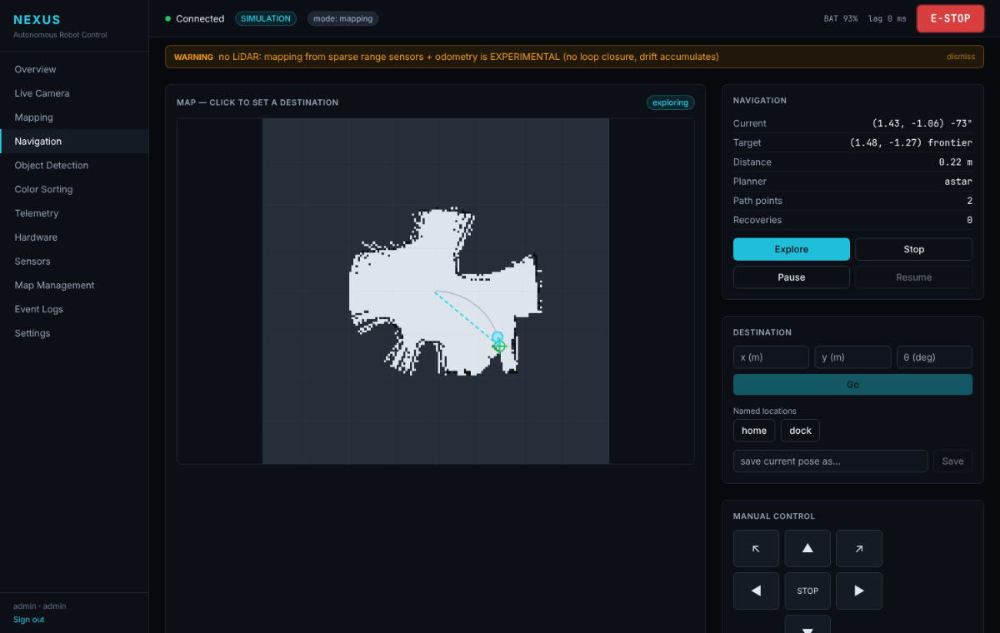

# PROJECT NEXUS

Autonomous vision-based indoor navigation and colour-sorting robot for the
Raspberry Pi 5. It maps a room, plans and follows paths around obstacles,
finds objects by colour and sorts them into bins with a servo arm. It runs
fully offline and comes with a web dashboard for live control.

* **Two operating modes**: autonomous mapping/navigation, and colour sorting.
* **Same code in simulation and on hardware**: business logic only talks to
  hardware interfaces. A built-in 2D simulator (ray-cast sensors, a synthetic
  camera, an arm and bins) lets the whole stack run without a robot.
* **Safety first**: a physical e-stop relay, plus a single software safety
  controller that every motion command goes through (stop/slow zones,
  latched e-stop and faults, stale-sensor blocking, command watchdog,
  battery cut-off, stall detection).
* **Honest results**: a sort counts as successful only when the bin sensor
  confirms the drop. Maps made without a LiDAR are labelled experimental.
  Simulated data is always marked as simulated.



## Repository layout

```
robot/          robot runtime: hardware abstraction, drivers, simulation,
                vision, mapping, navigation, sorting, safety
backend/        FastAPI app: REST, WebSocket, auth, database
frontend/       React + TypeScript + Tailwind dashboard (12 screens)
ros2_ws/        optional ROS 2 Jazzy packages (Nav2, SLAM Toolbox)
config/         nexus.yaml (all tunables) and simulated worlds
scripts/        Pi setup, hardware check, calibration, simulation, benchmark, backup
tests/          unit, integration (API + closed-loop simulation), hardware-in-the-loop
deployment/     systemd units, Dockerfile
docs/           architecture, hardware, guides, reports
```

## Quick start (simulation)

```bash
python3 -m venv .venv && . .venv/bin/activate
pip install -r requirements.txt
python3 -m pytest                                   # 86 passed, 7 hardware tests skipped
(cd frontend && npm ci && npm run build)
python3 -m backend.main
```

Open http://localhost:8000 and log in as `admin`. The password is in
`data/initial_admin_password`, or whatever you set as `NEXUS_ADMIN_PASSWORD`
in `.env`. Docker alternative: `docker compose up --build`.

Headless demos:

```bash
python3 scripts/sim_explore.py --minutes 2     # frontier exploration, saves a map
python3 scripts/sim_sort.py --minutes 3        # colour sorting
python3 scripts/benchmark.py --sorting         # performance + accuracy numbers
```

## On the robot

See the [installation guide](docs/installation.md): flash Raspberry Pi OS 64-bit,
wire the robot following [wiring.md](docs/hardware/wiring.md), then run
`sudo ./scripts/setup_pi.sh` and `scripts/hardware_check.py`, and start
`nexus.service`.

## Documentation

| Topic | Document |
|---|---|
| System architecture, threads, safety design | [docs/architecture.md](docs/architecture.md) |
| Bill of materials (INR), compatibility matrix | [docs/hardware/bom.md](docs/hardware/bom.md) |
| Power, e-stop circuit, GPIO pinout, wiring | [docs/hardware/wiring.md](docs/hardware/wiring.md) |
| Mechanical assembly | [docs/hardware/assembly.md](docs/hardware/assembly.md) |
| Installation and Raspberry Pi setup | [docs/installation.md](docs/installation.md) |
| Calibration | [docs/calibration.md](docs/calibration.md) |
| User manual | [docs/user-manual.md](docs/user-manual.md) |
| API (REST + WebSocket) | [docs/api.md](docs/api.md) |
| Database and ER diagram | [docs/database.md](docs/database.md) |
| Troubleshooting | [docs/troubleshooting.md](docs/troubleshooting.md) |
| Test report | [docs/test-report.md](docs/test-report.md) |
| Benchmark report | [docs/benchmark-report.md](docs/benchmark-report.md) |
| Demo script | [docs/demo.md](docs/demo.md) |
| Presentation | [docs/presentation.md](docs/presentation.md) |
| Roadmap and acceptance status | [docs/roadmap.md](docs/roadmap.md) |
| ROS 2 workspace | [ros2_ws/README.md](ros2_ws/README.md) |

## Status

Everything in this repository has been tested in simulation, and the
dashboard has been checked in a browser against the simulated robot.
**Nothing has been validated on physical hardware yet.** That includes the
Raspberry Pi drivers, the ROS 2 packages and all of the acceptance criteria
that need the real robot. See [docs/roadmap.md](docs/roadmap.md) for the
item-by-item status, and record hardware results in the test and benchmark
reports.

## License

Apache 2.0, see [LICENSE](LICENSE).
