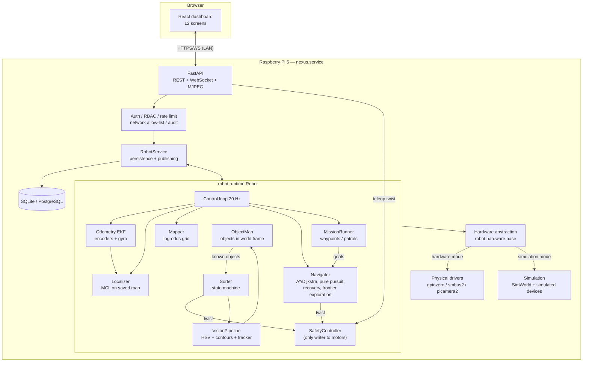
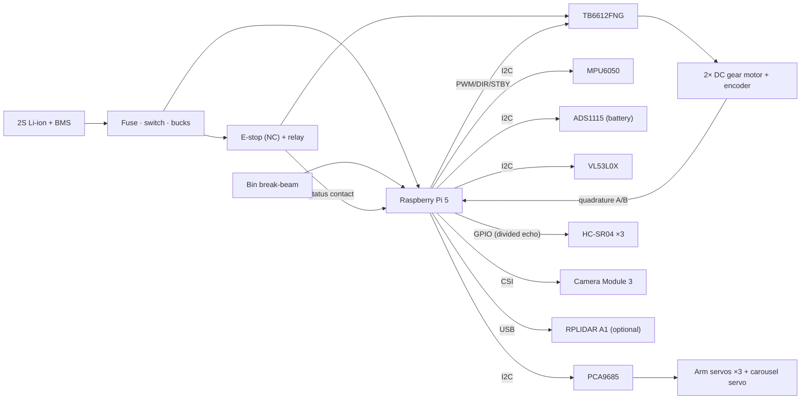
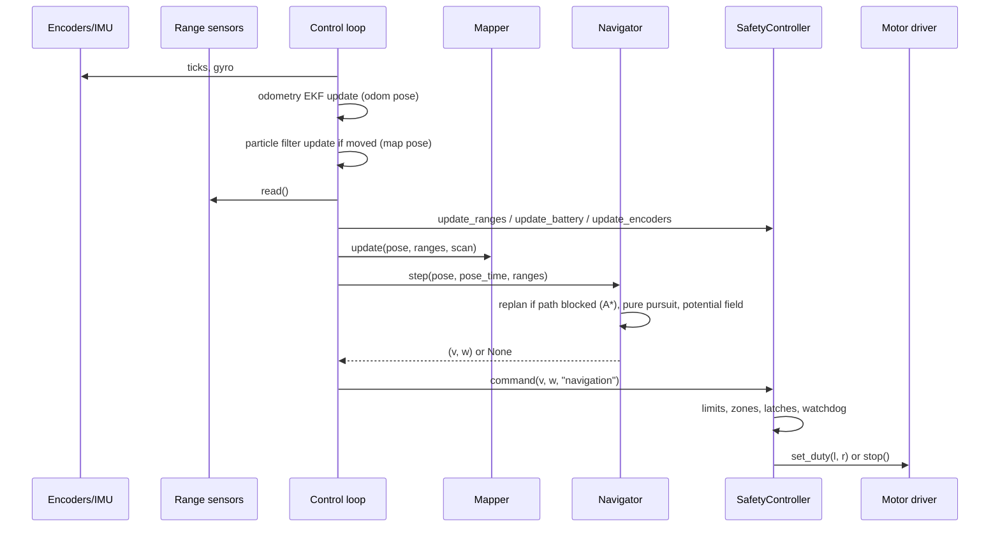

# System architecture

## Overview

NEXUS has two ways to run, sharing the same robot code:

1. **Standalone stack** (default): one Python process on the Pi runs the
   robot runtime (hardware, safety, mapping, navigation, vision, sorting)
   and the FastAPI server that serves the React dashboard. No ROS needed.
2. **ROS 2 stack** (optional, needs a LiDAR for SLAM): `nexus_base` wraps the
   same hardware layer and safety controller; Nav2 and SLAM Toolbox take
   over mapping, localisation and planning.

## Hardware block diagram

## Layers and responsibilities

| Layer | Package | Responsibility |
|---|---|---|
| Hardware interfaces | `robot/hardware/base.py` | Abstract `Device` classes with initialise / validate / health / shutdown |
| Physical drivers | `robot/motors`, `robot/sensors`, `robot/camera`, `robot/hardware/servos.py` | Talk to real chips; raise `HardwareUnavailable` when absent |
| Simulation | `robot/simulation` | 2D world (ray casting, collisions, objects) and devices implementing the same interfaces |
| Factory | `robot/hardware/factory.py` | Probes devices, records missing ones, derives `capabilities` |
| Safety | `robot/safety/controller.py` | Velocity/accel limits, obstacle zones, e-stop latch, battery, stale data, watchdog, stall detection |
| Localisation | `robot/localization` | Odometry EKF (encoders + gyro), particle filter with likelihood field and correlative global search, map←odom correction — see [localization.md](localization.md) |
| Perception | `robot/vision` | HSV segmentation, morphology, contour filtering, contrast check, confidence, tracking, calibration, object map (world positions of detections) |
| Mapping | `robot/mapping` | Log-odds occupancy grid, ROS map_server I/O, map store |
| Navigation | `robot/navigation` | Planners, path simplification, pure pursuit, potential field, state machine, waypoint missions |
| Sorting | `robot/sorting` | Arm sequences, search/approach/pick/verify/drop state machine |
| Runtime | `robot/runtime.py` | Owns everything, runs the control loop, enforces mode rules |
| Backend | `backend/` | REST, WebSocket, auth, persistence, simulation control, Prometheus metrics |
| Frontend | `frontend/` | Dashboard |
| ROS 2 | `ros2_ws/src` | Optional Nav2/SLAM integration |

Business logic never imports a driver; it receives interfaces from the
factory (dependency injection). The same `Navigator`, `Sorter` and
`SafetyController` run against simulated and physical devices, and every
health/telemetry message carries a `simulated` flag.

## Threads (standalone stack)

| Thread | Rate | Work |
|---|---|---|
| `control` | 20 Hz | read encoders/IMU/ranges/battery → odometry EKF → particle filter (on motion) → safety inputs → mapper → navigator → missions → safety tick; low-battery return check at 1 Hz |
| `vision` | camera FPS (15) | grab → quality check → detect → track → JPEG encode |
| `cam-*` | camera rate | capture into a 1-frame buffer (always newest frame) |
| `sorter` | 10 Hz | sorting state machine (blocking arm moves) |
| `ws-publisher` | 10 Hz | telemetry/pose/detections to WebSocket; telemetry to DB every 5 s |
| `sim-clock` | 100 Hz | simulation only: physics step |
| uvicorn event loop | — | HTTP, WebSocket fan-out, MJPEG streaming |

## Safety design

Defence in depth, from most to least independent:

1. **Physical e-stop** opens the motor supply relay. Works with the Pi
   crashed or powered off.
2. **BMS** cuts the battery on over-discharge/short.
3. **SafetyController** (software): the only code path to the motor
   driver. Every command source (teleop, navigation, sorting, ROS
   `/cmd_vel`) goes through `command()`.
   * e-stop (hardware input or software) latches; releasing the button
     does not restart motion, an operator reset is required;
   * faults (undervoltage, motor communication, drive stall) latch until
     cleared;
   * forward motion blocked inside the stop zone, scaled in the slow zone,
     blocked if the front sensors are stale or invalid;
   * reverse limited to 0.06 m/s (no rear sensors);
   * command watchdog: no new command for 0.6 s → stop;
   * velocity and acceleration limits.
4. **Navigator** holds position when the pose is invalid or stale (including
   a lost or still-searching particle filter) and gives up after a bounded
   number of recoveries.
5. **Low battery**: below `navigation.return_voltage` the current task is
   aborted and the robot drives to the dock; below
   `safety.battery_min_voltage` all motion is refused.
6. **API**: operator role required for motion, motion commands rate
   limited, emergency stop open to every logged-in user and exempt from
   rate limiting.

## Data flow for one navigation cycle

## Mapping modes

| Sensors | Mode | Quality |
|---|---|---|
| LiDAR + encoders (+IMU) | SLAM Toolbox (ROS 2) or built-in grid | metric map, loop closure with SLAM Toolbox |
| Ultrasonic/ToF + encoders (+IMU) | built-in grid, **experimental** | rough outline only: 3–4 wide beams, no scan matching, odometry drift uncorrected |
| Camera only | not supported | a single uncalibrated RGB camera gives no reliable metric depth |

The dashboard labels experimental maps and saved maps keep the flag in their
YAML (`nexus.experimental: true`).

## Operator features added in v1.1

| Feature | Where |
|---|---|
| Map localisation (MCL), initial pose, global localisation | `robot/localization`, *Navigation* screen, `/api/localization/*` |
| Waypoint missions and patrol loops, stored in the database | `robot/navigation/missions.py`, *Missions* screen, `/api/missions/*` |
| Automatic return to dock on low battery | `Robot._check_low_battery`, `navigation.return_*` config |
| Object map: detections placed in the world, sorter drives to known objects | `robot/vision/object_map.py`, *Object Detection* screen |
| Simulation control room: fault injection, kidnapping, obstacles, scenario objects, ground-truth map | `backend/api/sim_routes.py`, *Simulation* screen (simulation mode only) |
| Prometheus metrics | `GET /metrics` |

## Added in v1.2

| Feature | Where |
|---|---|
| LiDAR scan-to-map matching while mapping (SLAM without ROS) | `robot/mapping/scan_matcher.py`, `Robot._scan_match` |
| Dynamic Window Approach local planner (default controller) | `robot/navigation/dwa.py` — see [navigation.md](navigation.md) |
| Flight recorder + offline replay | `robot/recorder.py`, `scripts/replay.py`, `/api/recordings/*` |
| Coverage (lawnmower) missions, mission schedules | `robot/navigation/coverage.py`, `robot/navigation/scheduler.py` |
| Shape classification, gray-world and reference white balance | `robot/vision/detector.py`, `/api/vision/white-balance` |
| Phone-friendly dashboard | `frontend/src/components/Layout.tsx` |
