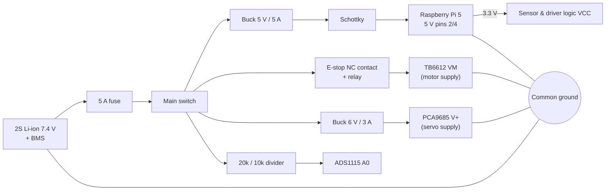

# Wiring, power and GPIO allocation

All pin numbers are **BCM GPIO numbers** (as used in `config/nexus.yaml`),
with the physical header pin in brackets.

## Power architecture



Rules this design follows:

* Motors and servos have their **own regulated supplies**; nothing heavy is
  powered from the Pi's 5 V or 3.3 V pins or from GPIO.
* The Pi 5 V input has a **Schottky diode** so the Pi cannot backfeed the
  buck converter or be backfed through USB when the switch is off, and
  motor current spikes do not reach the Pi.
* All grounds are joined at a **single star point** near the battery.
* The **e-stop is a normally-closed mushroom switch with two contacts**:
  contact 1 drops the relay that supplies TB6612 `VM` (motors lose power
  regardless of software), contact 2 goes to GPIO 4 so the software knows
  and latches the stop. A broken wire reads as "pressed" (fail-safe).
* The BMS cuts the pack at ~2.5 V/cell; the software warns at 7.0 V and
  refuses motion below 6.6 V (`safety.battery_*` in the config).

## E-stop circuit

```
 Battery+ ──fuse──switch──┬──────────────► Buck 5 V ──► Pi
                          │
                          └──► Relay COM ──NO──► TB6612 VM
                                  │
 3.3 V ──[relay module VCC]       coil driven by:
 Relay IN ◄── 5 V via E-stop contact 1 (NC)    (pressed = coil off = motors unpowered)

 GPIO 4 [7] ──── E-stop contact 2 (NC) ──── GND
         (internal pull-up: closed = 0 = released, open = 1 = pressed)
```

## GPIO allocation

| Function | BCM | Header pin | Direction | Notes |
|---|---|---|---|---|
| I2C SDA | 2 | 3 | bus | MPU6050, VL53L0X, ADS1115, PCA9685 |
| I2C SCL | 3 | 5 | bus | 400 kHz OK |
| E-stop input | 4 | 7 | in, pull-up | NC to GND |
| Ultrasonic L echo | 8 | 24 | in | **via 1k/2k divider**; SPI must be off |
| Ultrasonic L trigger | 7 | 26 | out | |
| Ultrasonic R trigger | 9 | 21 | out | |
| Ultrasonic R echo | 11 | 23 | in | **via divider** |
| Motor AIN1 | 5 | 29 | out | left motor direction |
| Motor AIN2 | 6 | 31 | out | |
| Motor PWMA | 12 | 32 | PWM | hardware PWM0 |
| Motor PWMB | 13 | 33 | PWM | hardware PWM1 |
| Motor STBY | 16 | 36 | out | low = driver disabled |
| Left encoder A | 17 | 11 | in | |
| Bin break-beam | 18 | 12 | in, pull-up | active low |
| Motor BIN1 | 20 | 38 | out | right motor direction |
| Motor BIN2 | 21 | 40 | out | |
| Right encoder A | 22 | 15 | in | |
| Right encoder B | 23 | 16 | in | |
| Ultrasonic F trigger | 24 | 18 | out | |
| Ultrasonic F echo | 25 | 22 | in | **via divider** |
| VL53L0X XSHUT | 26 | 37 | out | re-address at boot |
| Left encoder B | 27 | 13 | in | |

Free for expansion: GPIO 10, 14, 15, 19 (UART on 14/15).

## Connection details

### TB6612FNG

| TB6612 | Connects to |
|---|---|
| VM | relay NO (motor battery, 7.4 V) |
| VCC | Pi 3.3 V (pin 1) |
| GND (all) | common ground |
| AO1/AO2 | left motor |
| BO1/BO2 | right motor |
| PWMA, AIN1, AIN2 | GPIO 12, 5, 6 |
| PWMB, BIN1, BIN2 | GPIO 13, 20, 21 |
| STBY | GPIO 16 |

If a wheel turns backwards, swap the motor wires or set
`hardware.motor_driver.invert_left/right`.

### HC-SR04 (×3)

HC-SR04 runs on 5 V and its ECHO output is 5 V. **Never connect ECHO
straight to the Pi.** Use a divider on each echo line:

```
ECHO ──[1 kΩ]──┬── GPIO
               └──[2 kΩ]── GND        (5 V × 2/3 = 3.3 V)
```

VCC → 5 V (from the 5 V buck, not the Pi pin if many sensors), TRIG → GPIO
directly (3.3 V is enough to trigger).

### I2C devices

All on bus 1 (pins 3/5), powered from 3.3 V:

| Device | Address | Notes |
|---|---|---|
| MPU6050 | 0x68 | AD0 to GND |
| ADS1115 | 0x48 | ADDR to GND; A0 = battery divider |
| PCA9685 | 0x40 | V+ from the 6 V servo buck, **not** from the Pi |
| VL53L0X | 0x29 → 0x30 | XSHUT on GPIO 26, re-addressed on start |

Check with `i2cdetect -y 1`.

### Battery divider

```
Battery+ ──[20 kΩ]──┬── ADS1115 A0        (8.4 V max → 2.8 V at A0)
                    └──[10 kΩ]── GND
```
`hardware.battery.divider_ratio: 3.0`. Measure the real ratio with a
multimeter and adjust for accuracy.

### Encoders

Power the encoder Hall sensors from **3.3 V** so their outputs are 3.3 V
logic. If your encoder needs 5 V, add a level shifter (e.g. BSS138 board).

### Servos

PCA9685 channels: 0 base, 1 shoulder, 2 gripper, 3 sorter carousel. Add a
470–1000 µF capacitor across V+/GND on the PCA9685 to absorb servo current
spikes.

### Bin break-beam

Emitter: 3.3–5 V + GND. Receiver: VCC, GND, signal → GPIO 18 (open
collector; the internal pull-up is enabled). Mount the beam across the
chute below the carousel so every dropped object breaks it.

## Pre-power checklist

1. Battery disconnected; check for shorts between battery+ and ground.
2. With only the 5 V buck connected (no Pi), set the output to 5.1 V.
3. Connect the Pi; boot; run `i2cdetect -y 1` (expect 0x40, 0x48, 0x68, 0x29).
4. Press the e-stop: the relay must click off and TB6612 VM must read 0 V.
5. Run `scripts/hardware_check.py`, then `--motor-test` with the wheels off the ground.
