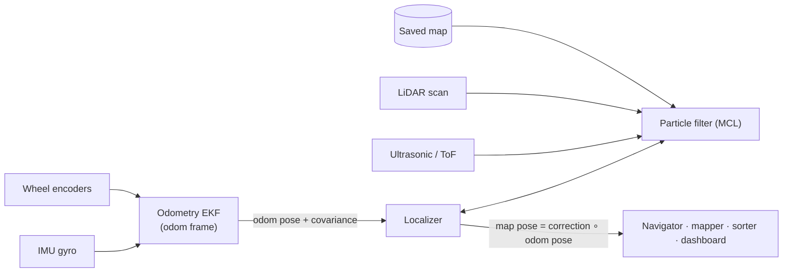
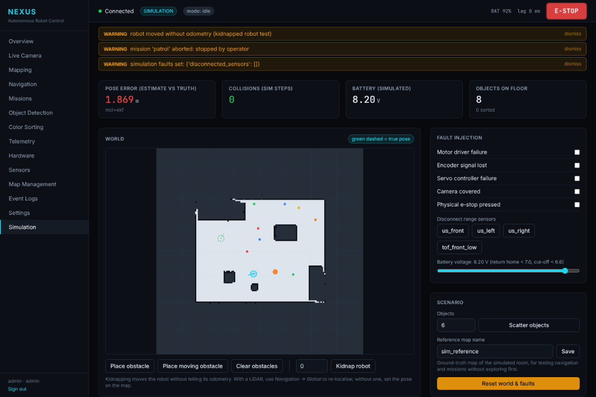

# Localisation

NEXUS estimates its pose in two layers, the same split ROS uses between the
`odom` and `map` frames.

## 1. Odometry EKF (`robot/localization/ekf.py`)

Runs every control cycle (20 Hz) whether or not a map is loaded.

* **Motion increment** from the encoders: distance `ds` and heading change
  `dθ_enc`. Noise grows with distance and, more strongly, with rotation,
  because wheel slip mainly corrupts rotation.
* **Gyro** heading change `ω_z·dt`, with noise that grows with time instead
  (rate noise plus residual bias after the start-up calibration).
* The two heading increments are fused with inverse-variance weights, then
  the pose `[x, y, θ]` and its 3×3 covariance are propagated with the
  unicycle model's Jacobians.

Using the increments directly as the control input (rather than a
constant-velocity state) avoids the one-step lag a velocity model has. The
pose covariance is published to the dashboard (σ ring around the robot) and,
in the ROS base node, in `nav_msgs/Odometry.pose.covariance`.

The odometry pose always drifts: a few percent of the distance driven, more
on slippery floors.

## 2. Monte Carlo localisation (`robot/localization/mcl.py`)

Active when a map is loaded (*Mapping → Load*) and localisation is enabled.
It never runs while mapping.

| Part | Implementation |
|---|---|
| Motion model | sample-based odometry model (rot1, trans, rot2), noise α = (0.08, 0.15, 0.08, 0.02) |
| Sensor model | likelihood field: distance transform of the occupied cells, Gaussian σ_hit = 8 cm + 15 % random; vectorised over particles × beams |
| Beams | up to 72 LiDAR beams (subsampled to 36), plus the ultrasonic/ToF beams from their mounting offset |
| Resampling | low-variance, when N_eff < N/2 or the scan matches poorly |
| Recovery | random particles injected while the scan matches poorly (augmented MCL) |
| Update rate | after 5 cm or 0.1 rad of motion; ~1 ms per update with 400 particles on the dev VM |

The localiser keeps the **map ← odom correction** and only changes it when
the filter is confident. Between updates the pose follows odometry smoothly,
so the robot never sees a jump of more than one filter correction.

### Convergence and validity

The filter counts as **converged** when the particle cloud is tight
(σ < 15 cm, σθ < 0.25 rad) *and* the scan agrees with the map (mean per-beam
likelihood ≥ 0.7). A tight cloud with a poor scan match means it has
collapsed onto a look-alike place, so that is deliberately not called
converged.

The pose is reported **invalid** (the navigator holds still, missions and
navigation refuse to start) when:

* the cloud spreads beyond `lost_std_m` (0.5 m), or
* a global localisation is still searching.

### Initial pose

After loading a map, the filter starts around the robot's current estimate.
If the robot was carried somewhere else, tell it where it is:
*Navigation → Set pose on map* (click the position, enter the heading), or
`POST /api/localization/initial-pose`.

### Global localisation (LiDAR only)

*Navigation → Global*, or `POST /api/localization/global`. On the next full
scan the localiser runs a **correlative search**: every free position on a
10 cm grid × 36 headings is scored against the scan with the likelihood
field, and the filter is seeded around the 12 best candidates with 10× the
usual particle count. As the robot turns or moves, the wrong candidates lose
weight; once converged the filter shrinks back to 400 particles.

| Kidnapped (estimate cyan, truth green dashed) | After *Global* + a short spin |
|---|---|
|  |  |

In simulation (5 × 4 m room) this re-localised a kidnapped robot to 3–4 cm
in 5 of 5 trials within about 2 s of spinning in place. Uniform random
particles alone sometimes locked onto the wrong place, which is why the
search is used.

## 3. Scan matching while mapping (`robot/mapping/scan_matcher.py`)

The particle filter needs a finished map. While a LiDAR robot is still
building the map, each scan is aligned with the map built so far before it
is inserted (correlative scan matching):

* a coarse brute-force search over ±12 cm × ±0.12 rad (2 cm / 0.015 rad
  steps) around the odometry prediction, then a fine pass at ¼ of the
  steps around the best result;
* each candidate is scored with the same likelihood field as the particle
  filter, using bilinear interpolation;
* the result is accepted only if the score is ≥ 0.45 and better than the
  odometry guess. The map ← odom correction is then updated, so the
  exploration planner and the dashboard use the corrected pose.

In simulation (5 % odometry error):

| | Odometry only | Scan matching |
|---|---|---|
| Final pose error, manual mapping drive | 31.5 cm | 0.5–2 cm |
| Final pose error, 4.5 m offline route (`benchmark.py`) | 63 cm | 0.3 cm |
| Map wall precision (occupied cells on a true wall) | 20–31 % | 83–100 % |
| Match time | — | 6 ms live, 15 ms offline benchmark (dev VM) |

There is no loop closure, so drift can still build up over long loops in
large spaces; with ROS 2, SLAM Toolbox is the better tool for those.

### Map bias fix (v1.2)

Writing the scan matcher exposed a half-cell (2.5 cm) shift in every map.
A ray ending exactly on a cell boundary was marked in the cell behind the
wall when travelling in +x/+y, but in front of the wall when travelling in
−x/−y. Hits are now placed a quarter cell past the surface, and the distance
field is read with bilinear interpolation. Particle-filter tracking error
fell from 4.3 cm to 1.9 cm, and global localisation error from 3.3 cm to
0.8 cm.

### Lost-while-stationary fix (v1.2)

The filter used to update only after the robot moved. A robot that lost
confidence would then stop, as it must, and never recover. When not
converged, the filter now also updates every 0.5 s while standing still.
The "scan match" quality is now weighted by particle weight, and random
particles are injected *before* weighting, so a deliberately spread initial
cloud no longer looks like a lost robot.

## 4. Modes (`config/nexus.yaml → localization.mode`)

| Mode | Behaviour |
|---|---|
| `auto` (default) | MCL only when a LiDAR is detected |
| `on` | MCL always; without LiDAR it is labelled **experimental** |
| `off` | odometry EKF only |

Why `auto` excludes ultrasonic-only robots: three or four wide ultrasonic
beams carry too little information to localise. The filter can slow drift
when the starting pose is known, but it also tends to become overconfident.
Use `on` only to experiment, and keep resetting the pose when it drifts.

## 5. Known limitations

* **Wheel slip against furniture**: if the robot pushes against an obstacle
  in a sensor blind spot, the encoders report motion that did not happen.
  The filter can diverge. It then reports the pose invalid, and with a LiDAR
  the random injection or a global localisation recovers it. The three
  ultrasonic sensors leave blind sectors around ±30°: a front-corner bumper
  or a LiDAR closes them.
* **Changed rooms**: moved furniture lowers the scan match. Small changes
  are tolerated by the 15 % random term; large changes need a new map.
* **Symmetric rooms**: a perfectly symmetric room has several equally good
  poses. Global localisation then keeps several clusters until a
  distinguishing feature comes into view, and the pose stays invalid until it
  does.
* All numbers above are from simulation. Validate on the real robot before
  relying on them (`docs/test-report.md`).
