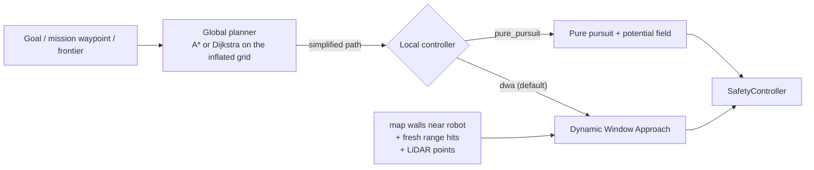

# Navigation and missions

## Global planning

`robot/navigation/planners.py`, 8-connected A* (default) or Dijkstra on the
occupancy grid:

* obstacles inflated by `navigation.inflation_radius_m` (0.18 m);
* recent range-sensor hits (last 4 s) added as obstacles;
* a clearance cost keeps paths away from walls where there is room;
* no corner cutting; the path is simplified by line-of-sight pruning;
* unknown space is blocked unless `allow_unknown: true` (exploration allows it).

The path is replanned when the next few waypoints become blocked.

## Local control

### Dynamic Window Approach (`controller: dwa`, default)

`robot/navigation/dwa.py`, each control cycle (20 Hz):

1. **Dynamic window**: (v, ω) reachable within 0.3 s under the acceleration
   limits, sampled 7 × 17 (+ stop and pure rotation).
2. **Rollout**: constant-twist arcs over 1.6 s.
3. **Collision check**: every arc is checked *at least 0.45 m ahead*,
   regardless of speed, against map walls within 1 m, range hits from the
   last second, and the current LiDAR scan. A purely time-based check would
   let a slow arc creep straight at an obstacle. Near the goal the check is
   shortened to the remaining distance, so goals close to walls stay reachable.
4. **Score**: progress towards a point 0.5 m ahead on the path (plus final
   heading), clearance (capped at 0.5 m), and speed.

If no arc is collision-free the robot stops; the stuck detector then
starts a recovery (back off, turn, replan).

### Pure pursuit (`controller: pure_pursuit`)

Follows the lookahead point. A potential field bends the command away from
close range readings; it is ignored while turning on the spot.

### Comparison (simulation, `tests/integration/test_autonomy.py::test_unmapped_obstacles`)

| Scenario | Pure pursuit | DWA |
|---|---|---|
| Box on the path, not in the map | reached, 15.7 s, 0 collisions | reached, 14.2 s, 0 collisions |
| Obstacle crossing the path (0.12 m/s) | reached, 11.8 s, 0 collisions | reached, 13.4 s, 0 collisions |
| Crossing obstacle, with LiDAR | reached, 11.8 s, 0 collisions | reached, 13.3 s, 0 collisions |

Both work. DWA is the default because every command it sends is a
dynamically feasible, collision-checked arc, and it uses LiDAR points
directly. It is not dramatically faster in these scenarios.

### Stuck detection

A recovery starts after `stuck_timeout_s` (6 s) without progress. Progress
means the distance to the goal shrinks by 5 cm *or* the heading error
towards the path shrinks by 0.2 rad (v1.2), so turning on the spot before
driving off is not mistaken for being stuck. After `max_recoveries` (3) the
goal fails with the reason.

## Missions

`robot/navigation/missions.py`. Waypoints are coordinates or named
locations, each with an optional dwell time. Options: loop with a maximum
loop count, return home at the end, and skip or abort when a waypoint is
unreachable. Missions are stored in the database.

### Coverage missions (v1.2)

`robot/navigation/coverage.py`, *Missions → Coverage mission*, or
`POST /api/missions/coverage`: a boustrophedon (lawnmower) sweep over the
free space of the loaded map. Rows run `spacing` apart, each split into
free segments between inflated obstacles and visited in alternating
direction. Missions are limited to 100 waypoints, so increase the spacing
for large rooms.

### Schedules (v1.2)

`robot/navigation/scheduler.py`, *Missions → Schedules*: start a mission at
a local time on selected weekdays. It fires at most once per day, within
10 minutes of the set time, so a reboot does not start a patrol hours late.
If the robot is busy, e-stopped or not localised, that run is skipped and an
event is logged; it is not queued.

### Low battery

Below `navigation.return_voltage` (7.0 V) any mission, sorting run,
exploration or navigation is aborted and the robot drives to
`return_location` (`dock`).
