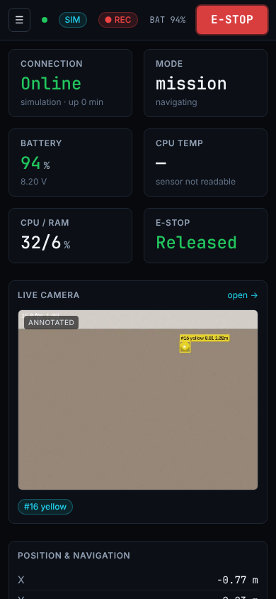
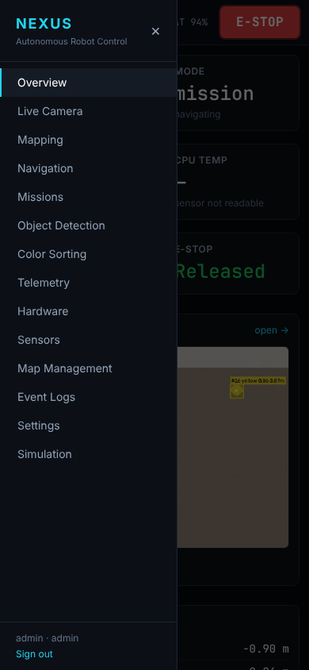

# User manual

## Safety first

* The red **mushroom button on the robot** cuts motor power instantly and
  works even if the software has crashed. Use it whenever something looks
  wrong. Twist to release; then press **Reset** next to the dashboard
  E-STOP button — motion stays disabled until an operator resets it.
* The **E-STOP button in the dashboard header** is available to every
  logged-in user on every screen.
* The robot never reverses faster than 6 cm/s (it has no rear sensors).
* The robot will not drive forward if the front sensors stop reporting.
* Stay within sight of the robot while it moves autonomously.

## Logging in and roles

Open `http://<robot>:8000`. Accounts are created by an admin under
*Settings*. Viewers can watch and stop; operators can drive and run tasks;
admins also manage users, safety limits and the system.

The header always shows: connection, **SIMULATION / HARDWARE** badge,
current mode, obstacle zone, battery, message lag and the E-STOP.

## Screens

| Screen | Use it to |
|---|---|
| Overview | check health at a glance: battery, CPU, pose, navigation, detections, sorted count, sensor health, e-stop |
| Live Camera | see the raw, annotated and mask feeds; start/stop the vision pipeline |
| Mapping | explore autonomously or map while driving; save/load/reset the map |
| Navigation | click on the map to send the robot somewhere; named locations; pause/resume/stop; localisation status, set initial pose, global localisation; manual drive pad |
| Missions | build waypoint missions and patrol loops on the map; start/stop; live progress |
| Object Detection | detection table; enable colours; tune filters; calibrate HSV thresholds |
| Color Sorting | start/pause/stop sorting; colour→bin mapping; bin fill levels; history; servo calibration |
| Telemetry | live charts of velocity, distances, battery, CPU; IMU; commanded vs applied velocity |
| Hardware | which devices were detected, which capabilities are enabled, configured pins |
| Sensors | top-down obstacle view with stop/slow zones; raw readings, encoders, battery |
| Map Management | load, rename, delete, download (PGM/YAML) saved maps |
| Event Logs | system events (filter, search, CSV export); admin: audit log |
| Settings | system info, backups, restart/power off, safety limits, users, password |
| Simulation | *(simulation mode only)* inject faults, kidnap the robot, place obstacles, scatter objects, save a ground-truth map, compare estimate with truth |

## Manual driving

*Navigation → Manual control*. Hold an arrow (or W/A/S/D, Q/E) to drive;
release to stop. Space or the STOP button stops immediately. Speeds are set
with the sliders and further limited by the safety controller (see
*Telemetry → Commanded vs applied* for why a command was reduced).

## Building a map

1. Place the robot in the room, wheels on the floor; the pose starts at
   (0, 0) facing +x.
2. *Mapping → Start autonomous exploration*. The robot first spins in place,
   then drives to the nearest unexplored boundary (frontier) repeatedly.
3. When it reports *exploration complete* (or you are satisfied), click
   **Stop mapping**, type a name and **Save**.

Without a LiDAR the dashboard shows **EXPERIMENTAL**: the map is a rough
outline from three ultrasonic beams and wheel odometry, and it drifts over
time. With a LiDAR, use the ROS 2 stack (SLAM Toolbox) for metric maps.

## Navigating

1. Load a saved map (or keep the one just built). Make sure the robot's
   pose matches: if you moved the robot, put it back at the map's start
   point and reset the pose.
2. Click a free spot on the map, or type coordinates, or pick a named
   location. The planned path appears as a dashed cyan line.
3. The robot replans when sensors see something blocking the path, tries
   up to 3 recoveries (back off, rotate) and then reports **failed** with
   the reason. It holds position if its pose becomes invalid.

## Localisation

The header pose comes from the odometry EKF (encoders + gyro). It drifts by
a few centimetres per metre. With a **LiDAR** and a loaded map, the
particle filter corrects it continuously. The map shows a violet particle
cloud, and the cyan ring around the robot is the 2σ uncertainty. See
[localization.md](localization.md).

* After loading a map, or after carrying the robot somewhere: *Navigation →
  Set pose on map*, enter the heading, then click where the robot stands.
* LiDAR only: **Global** finds the robot anywhere on the map. Let it spin
  or drive a little until the status says *localised*. Until then navigation
  is refused, because the pose is not trusted.

## Missions

1. Load a map and check the robot is localised.
2. *Missions*: name the mission, then click waypoints on the map (or add
   named locations). Set a dwell time per waypoint if wanted.
3. Options: **Loop** (patrol, optionally a maximum number of loops),
   **Return home at end**, and what to do if a waypoint is unreachable
   (**skip** it or **abort** the mission).
4. **Save**, then **Start**. Progress and skipped waypoints are shown under
   the map. Missions are stored in the database and survive restarts.

**Coverage mission**: generates a lawnmower sweep of the whole known floor
(choose the row spacing). Useful for patrols and for finding every object
before sorting.

**Schedules**: run a mission at a set time on chosen weekdays, for example
a weekday 21:00 patrol. If the robot is busy or not ready at that time, the
run is skipped and logged.

The local planner (DWA, green line on the map) steers around obstacles that
are not on the map. See [navigation.md](navigation.md).

If the battery drops below `navigation.return_voltage` (default 7.0 V)
during a mission, sorting run, exploration or navigation, the task is aborted
and the robot drives to the `dock` location. Below 6.6 V all motion is
refused.

## Sorting

1. Put the bins in place and empty them; click **Bins emptied**.
2. Check the colour→bin mapping (default red→1, green→2, blue→3, yellow→4,
   others→5) and the bin capacity.
3. Scatter test objects on the floor and click **Start**.
4. The robot searches (spins, relocates), approaches the largest object,
   aligns, picks it, checks the object left the floor, drops it into the
   bin and waits for the **bin break-beam** to confirm.
5. Results: `success` = confirmed by the bin sensor; `unverified` = no bin
   sensor installed; `failed_pickup` = still on the floor after the retries;
   `failed_verification` = released but the beam saw nothing.

Sorting stops by itself when no objects are found after 6 search cycles or
all bins are full.

With a calibrated camera, every object the robot has seen is placed on the
map (*Object Detection → Objects on the map*). When nothing is in view, the
sorter drives towards the nearest remembered object instead of searching
blindly.

## Flight recorder

*Event Logs → Flight recorder*: **Start recording** logs every control cycle
(encoder ticks, gyro, range sensors, LiDAR scans, commands, pose estimates;
ground truth in simulation) to a compressed file. The header shows ● REC
while it runs. **Download** the file and replay it on a laptop:

```bash
python3 scripts/replay.py run_202611011530.jsonl.gz
python3 scripts/replay.py run.jsonl.gz --no-scan-matching --map-out test_map
```

Replay rebuilds odometry, the map and scan matching with the parameters you
choose and prints the trajectory error. Use it to tune the robot without
re-running it.

## Coloured lighting

If colours are misdetected under warm or coloured light: *Object Detection
→ White balance*. Hold a white sheet in the sample region and click
**Measure from white sheet**. **Gray world** needs no sheet but works
poorly on tinted floors. Check the HSV thresholds afterwards. Detections
now also report a shape (circle, square, rectangle, triangle).

## On a phone

The dashboard works on phones: the menu opens from ☰ and the E-STOP stays
in the header on every screen.

| Overview | Menu |
|---|---|
|  |  |

## Simulation control (simulation mode only)

The *Simulation* screen is a test bench:

* **Fault injection**: motor driver, encoders, servo controller, covered
  camera, the physical e-stop, individual range sensors, battery voltage.
  Use it to check that each fault is reported and handled safely before
  testing on hardware.
* **Kidnap robot**: moves the robot without telling its odometry. Compare
  the estimate (cyan) with the true pose (green dashed) and practise
  re-localisation.
* **Obstacles**: static or moving, placed with a click.
* **Scenario**: scatter test objects, save a ground-truth map of the room
  (lets you test navigation and missions without exploring first), reset
  everything.

## Shutting down

*Settings → Power off* (admin), or press the e-stop and switch off. Avoid
cutting power without shutting down: the SD card can be corrupted.
